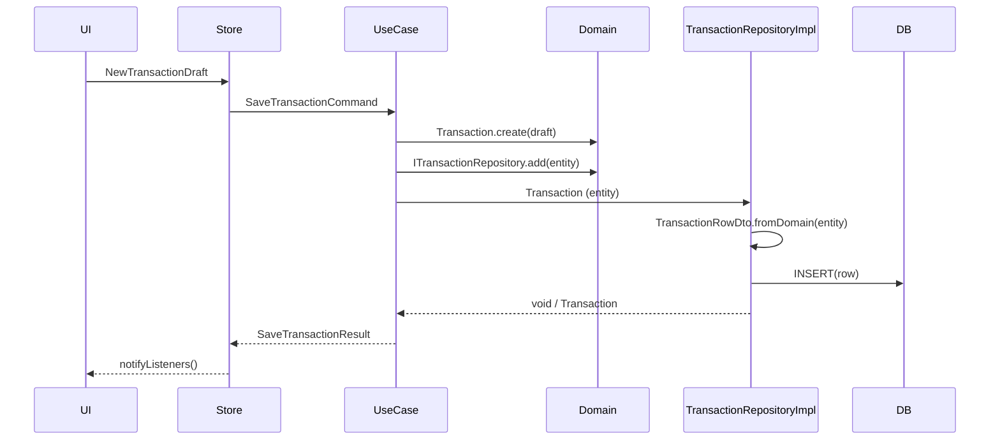
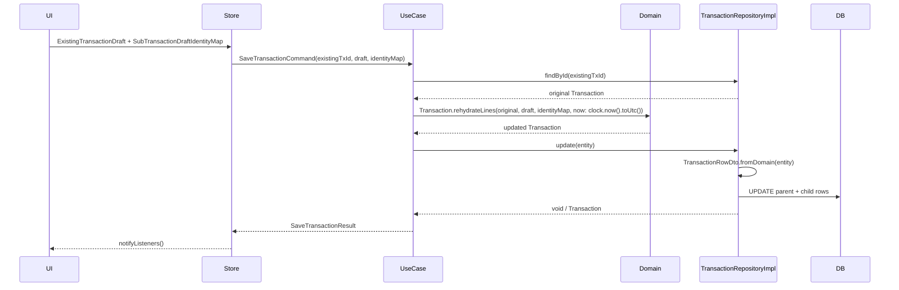
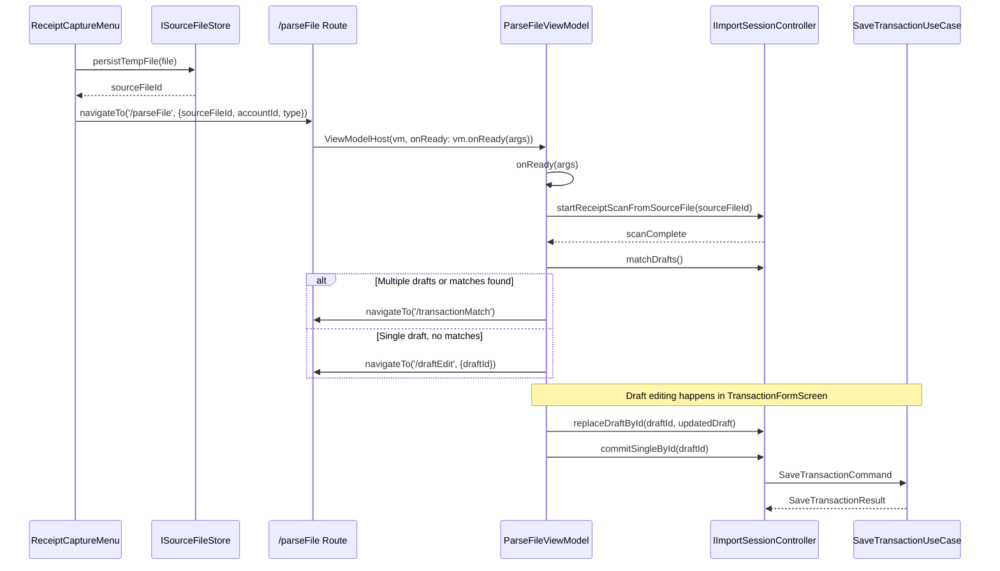

# Architecture Overview

Brief summary: High-level architecture summary and core patterns for the Home Accounting app.

## When to use this doc

Use this overview to orient yourself before implementing or reviewing app features. It covers the presentation stack pattern, data flow scenarios, and key architectural workflows.

## Executive summary

- **Domain-Centric Flutter Architecture**: MVVM + Clean Architecture principles.
- **Presentation**: Router → ViewModelHost → Screen (Provider-based DI).
- **Persistence**: Local SQLite (Drift) with persist-first file handling.
- **State Management**: Stores (ChangeNotifier) for global state; ViewModels for UI orchestration.
- **Layers**: Presentation (Widgets/VMs/Drafts) → Application (Stores/Use-Cases) → Domain (Entities/Repository Interfaces) → Data (Repository Impls/DTOs).

## Presentation Layer Pattern (MVVM)

The application follows a standardized **Router → ViewModelHost → Screen** composition pattern to ensure testability and separation of concerns.

### The Stack

```
Route (primitive args) ──▶ Router (composition root)
             └──────────▶ build typed Args (presentation-only)
                         └▶ resolve services via Provider (context.read<T>())
                         └▶ new ViewModel(services)
                         └▶ ViewModelHost(vm, onReady: vm.onReady(args))
                                   └▶ Screen reads vm state, calls vm methods
```

### Component Roles

- **Router (Composition Root)**:
  - Reads **primitive** route arguments (`int`, `String`, `bool`, …).
  - Validates and builds a **typed Args object** (presentation-only struct).
  - Resolves services via **Provider** (`context.read<T>()`) from the widget tree.
  - Constructs the ViewModel by **injecting** dependencies via constructor.
  - Wraps the Screen with `ViewModelHost(vm, onReady: vm.onReady(args))`.

- **ViewModelHost**:
  - Tiny helper widget that provides the VM to the subtree with `ChangeNotifierProvider.value`.
  - Calls `onReady(args)` once after the first frame.
  - Disposes the VM when popped.

- **ViewModel**:
  - Holds orchestration logic, uses services, exposes state (`isBusy`, `progress`, `error`).
  - **No `GetIt` calls** inside methods.
  - **No async work in constructor**; all side-effects happen in `onReady(args)`.
  - Can navigate via `INavigationService`.

- **Screen (Widget)**:
  - Pure rendering and user intent wiring (buttons → `vm.method()`).
  - **Never** reads `ModalRoute` or services; **never** starts work.
  - Reads VM state with `context.watch<TheVm>()`.
  - "Dumb" widgets: no service lookups, no route parsing, no side-effects.

## Data Flow Scenarios

### End-to-end Write Flow (Create)

This flow illustrates how data moves from the UI through layers to persistence, ensuring validation and separation of concerns.



**Key Principles:**
- **Validation once**: Domain guarantees invariants; Widgets stay lean.
- **Isolation**: Domain is agnostic of persistence details (no Drift/SQL knowledge).
- **Single Responsibility**: Use cases handle business operations; Stores manage state.

### Update Flow (Rehydrate with Identity Map)

Updating complex aggregates involves rehydrating the original entity and applying changes from a draft.



**Identity & Timestamp Rules:**
- Caller supplies `SubTransactionDraftIdentityMap`.
- **Timestamps**:
  - `createdAt` is preserved.
  - `updatedAt` changes only on material field changes.
  - Timestamps are produced in Domain via injected `Clock` (UTC) and persisted verbatim.
- **Deletions**: Persisted lines absent from the map are treated as deleted.

## Key Flows

### Receipt Ingestion (Persist-First Architecture)

The system follows a **persist-first** approach: files are permanently stored before processing begins to ensure data durability.



**Design Decisions:**
- **Persist-First**: No risk of data loss during crashes; files remain accessible for retry.
- **ID-Based API**: Draft operations use stable IDs (`replaceDraftById`), preventing index-based race conditions.
- **Non-Blocking**: `TransactionFormScreen` operates on draft copies; users can edit while background processing occurs.

### File Lifecycle

```
Temp File → persistTempFile() → Permanent Storage → Link on Commit
                ↓
        Thumbnails in /draftEdit via pendingFileIdForDraft + openFile
```

**One-Copy Rule:** Files are stored once and linked to transactions upon commit. No duplicate storage or complex cleanup logic.

## Example: Receipt Intake Walkthrough

1.  **Router (`/parseFile`)**:
    - Receives `{ sourceFileId:int, accountId:int, transactionType:String }` (primitives).
    - Builds `ParseFileArgs` (typed DTO).
    - Constructs `ParseFileViewModel` injecting `IImportSessionController`, `INavigationService`, etc. via `Provider`.
    - Wraps with `ViewModelHost`.
2.  **ViewModel**:
    - `onReady(args)`: Logic starts here.
    - Figures source/target accounts.
    - Calls `startReceiptScanFromSourceFile(...)` → waits for scan.
    - Calls `matchDrafts()`.
    - Branches navigation: multiple drafts/matches → `/transactionMatch`; single draft → `/draftEdit`.
3.  **Screen**:
    - Shows progress/error/cancel.
    - Never touches services or business logic.

## Related docs

- [Project Structure and Boundaries](/docs/app/reference/architecture/project-structure-and-boundaries.md)
- [Guardrails, Testing, and Process Patterns](/docs/app/reference/architecture/guardrails-and-testing.md)
- [Data Persistence](/docs/app/reference/architecture/data-persistence.md)
- [Contribution Guidelines](/docs/app/reference/contribution-guidelines.md)