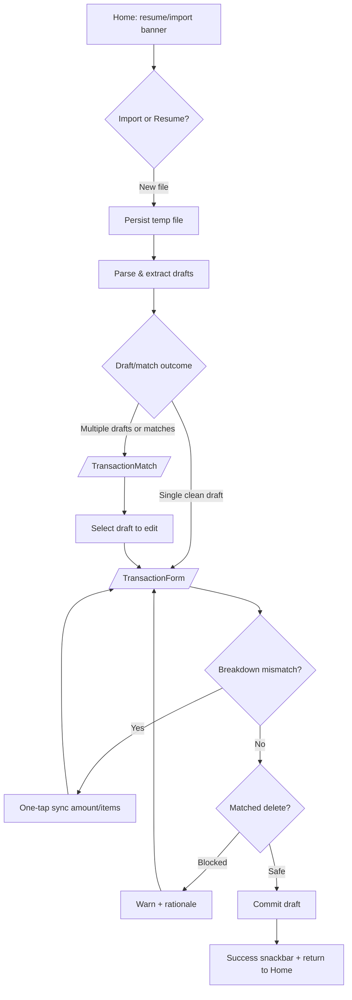

# UX Design Specification

Brief summary: Conceptual UX guidance for the home accounting app, covering experience goals, core flows, visual foundations, and interaction patterns.

## When to use this doc

Use this explanation when making product-level UX decisions, evaluating new flows, or aligning UI changes to the intended experience.

## Executive summary

- Vision: a mobile-first home accounting app that makes receipt ingestion effortless, keeps drafts safe while processing, and enables fast edits with clear status and feedback.
- Target users: household members and finance keepers who capture receipts or import statements on mobile and want reliable tracking without manual re-entry.
- Key challenges: communicating ingest/parse progress, guarding actions on matched transactions, and keeping scope-aware categories (transaction vs item) clear.
- Opportunities: strengthen the resume/import banner, improve mismatch guidance with one-tap sync, and keep semantic feedback consistent.

## Core user experience

### Defining experience

Capture → Parse/Match → Edit → Commit: users import or scan a receipt, see immediate progress, branch to match if needed, otherwise edit and commit with clear confirmation and guardrails.

### Platform strategy

- Mobile-first, touch-first UI.
- Works offline for viewing/editing drafts; parsing may require network when AI is used.
- Shallow navigation; replace when bouncing between matched peers.

### Effortless interactions

- One-tap start/resume from the home banner.
- Visible parse/progress states with retry/cancel actions.
- Fast edits for amount/date/category/breakdown with scope-aware pickers.
- One-tap mismatch sync for breakdown vs amount conflicts.

### Critical success moments

- Persisting a receipt and seeing immediate progress feedback.
- Correct branching to match vs edit without dead-ends.
- Guarded deletes and confirmations for matched items.
- Scope-aware categories that default correctly and avoid confusion.

### User mental model

- “I drop a file, the app does the heavy lifting, I just fix what’s needed.”
- Expect reliable storage first, then helpful automation; they dislike redoing work or losing drafts.
- Anticipate simple category choices and clear totals; expect matches/duplicates to be handled safely.
- Friction points: unclear parse status, back-stack confusion, scope-muddled categories, mismatch math.

### Success criteria

- Start/import is one tap with visible, accurate progress and safe cancel/retry.
- Correct branching: multi-draft/match → match screen; single clean draft → edit; no orphan states.
- Edit essentials fast: amount/date/category/breakdown with scope clarity and tolerance guidance.
- Guardrails: protected deletes when matched; clear reasons and next steps.
- Confirmation: clear commit success; undo/feedback for risky actions.

## Experience principles and emotional goals

- Persist-first clarity: always show current ingest/match state with safe exits.
- Guided fixes: inline, actionable help for errors and mismatches.
- Scope-smart choices: defaults honor transaction vs item context.
- Stay in flow: shallow navigation, predictable back behavior.
- Emotional goals: confidence, calm, and control through clear status and guardrails.

## UX pattern analysis and inspiration

### Inspiring products

- Apple Wallet / Files: clear ingest states and predictable back/cancel.
- Google Photos: resurfaced resume tasks and safe delete patterns.
- Revolut: semantic money/status colors and guarded destructive actions.

### Transferable patterns

- Resume banners for active imports.
- Inline progress with retry/cancel.
- Guarded deletes with rationale + undo.
- Clear breakdown and match badges.

### Anti-patterns to avoid

- Deep navigation stacks for match/edit flows.
- Vague errors without next steps.
- Mixed-scope category pickers and hidden mismatch fixes.

## Visual design foundation

### Color system

- Base: Material 3 tonal palette, with AppTokens as the semantic layer.
- Semantics: distinct tokens for income/expense/transfer, success/warning/error banners, import/progress states, mismatch/breakdown badges.
- Guidance: keep direct color definitions in `lib/app/theme/**`; consume via theme extensions.
- States: destructive/guarded actions use warning/error tokens with rationale; opacity via `Color.withValues` only where contrast stays compliant.

### Typography system

- Tone: friendly-professional, high readability.
- Faces: keep current Flutter defaults or a clean geometric sans when allowed; maintain a single primary family.
- Scale: Material 3 type scale with slight emphasis on titles/amounts; generous line height for small screens.
- Localization: all user-facing strings localized; maintain contrast and size for accessibility.

### Spacing and layout foundation

- Grid/spacing: 8px base with 4px sub-steps; compact list density with clear dividers.
- Layout feel: mobile-first, shallow navigation; prominent resume/import banners.
- Components: consistent button hierarchy (filled/tonal for primary, outlined for secondary); chips/pills for breakdown/mismatch badges.

### Accessibility considerations

- Contrast: meet WCAG AA for text on surfaces and semantic tokens.
- States and feedback: progress with both numeric percent and text; errors/warnings include clear next steps.
- Touch targets: maintain 44px minimum in dense lists and pickers.

## Design system foundation

- Base system: Material 3 with AppTokens for semantic money/status/banners/import state.
- Visual rules: avoid `Colors.*` in features/shared; use `Color.withValues` for opacity.
- Component theming via tokens and theme extensions.
- Localization and semantic keys are required (see UI/UX Guardrails for enforcement details).

## Design direction decision

The canonical design directions live in the HTML artifact, with a concise overview and baseline decision in the summary doc. This specification references those sources rather than duplicating direction details.

- [UX Design Directions Summary](/docs/app/explanation/ux-design-directions-summary.md)
- [UX Design Directions (HTML artifact)](/docs/assets/ux/ux-design-directions.html)

## User journey flows

### Receipt ingestion to commit



### Category management (scope-aware)

```mermaid
flowchart TD
  Entry[Open Category Management] --> Tabs{Scope tab}
  Tabs -->|Transaction| ListTx[Category list (transaction scope)]
  Tabs -->|Item| ListItem[Category list (item scope)]
  ListTx --> Rename[Inline rename]
  ListTx --> Emoji[Tap icon → emoji picker]
  ListTx --> Delete{Delete?}
  Delete -->|Confirm| Removed[Remove category]
  Delete -->|Cancel| ListTx
  ListTx --> AddTx[Add new category row]
  ListItem --> Rename
  ListItem --> Emoji
  ListItem --> Delete
  ListItem --> AddItem[Add new category row]
```

### Manual transaction creation

```mermaid
flowchart TD
  Home[Home: add transaction CTA] --> AddRoute[/AddTransaction route/]
  AddRoute --> Form[Transaction form (manual)]
  Form --> Account[Select account + type]
  Account --> Amount[Enter amount and date]
  Amount --> Category[Pick category (transaction scope)]
  Category --> Save{Save?}
  Save --> Commit[Commit transaction]
  Commit --> Done[Success + return to Home/list]
```

### Journey patterns and flow optimization

- Keep ingestion linear and shallow; replace navigation between matched peers.
- Show progress clearly with labeled bars; always pair blocks with rationale and next step.
- Default category pickers to the correct scope; keep mismatch fixes one-tap with clear affordances.
- Shared navigation, decision, and feedback patterns live in [UX Design Patterns](/docs/app/reference/ui-ux/ux-design-patterns.md).

## Component strategy (experience-critical)

### Design system components

- Material 3 foundation: buttons (filled/tonal/outlined), text fields, app bars, cards, lists/dividers, dialogs/sheets, chips, snackbars, progress indicators.
- Tokens: AppTokens for money/status/banners/import/mismatch; Theme extensions for semantic colors.

### Custom components

- Resume/Import Banner
  - Purpose: surface active import with progress, drafts count, resume CTA.
  - States: hidden / in-progress (percent) / paused (resume) / completed (dismissed).
  - Accessibility: announce progress; buttons labeled for resume/cancel.
- Match State Chip/Badge
  - Purpose: indicate matched/guarded items in lists/cards.
  - States: matched, matched-blocked-delete, unmatched.
  - Accessibility: semantic label for state; tooltip rationale for blocked actions.
- Mismatch Banner (Edit)
  - Purpose: show breakdown vs amount mismatch and offer one-tap sync actions.
  - Content: short description, two buttons; uses warning tokens.
  - Accessibility: buttons labeled for sync actions; banner announced when shown.
- Scoped Category Tabs/Picker
  - Purpose: switch between transaction/item scopes and select categories with emoji/icons.
  - States: transaction / item tab; loading; empty; error.
  - Accessibility: tabs labeled; tooltips clarify scopes; list items have semantic labels.
- Receipt/Import Progress Card (routes)
  - Purpose: show parse progress, error, retry/cancel in intake screens.
  - States: loading with labeled progress; error with retry; canceled; success routes onward.
  - Accessibility: progress announced; buttons labeled; errors in plain language.

### Component implementation strategy

- Build on Material 3 + AppTokens; no `Colors.*` in features/shared; all semantic colors via tokens.
- Keep variants lean: filled/tonal for primary actions, outlined for secondary; chips/pills for match/import/mismatch states.
- Ensure localization and semantic labels/tooltips for scope tabs, warning banners, and guardrails.
- Reuse progress patterns (labeled bars) and snackbars with semantic types for confirmations/warnings.

## Responsive design and accessibility

### Responsive strategy

- Mobile-first (primary target): single-column, bottom actions where possible, shallow navigation; resume/import banner near top.
- Tablet: allow split panes where useful (list + detail), larger gutters; keep touch targets ≥44px.
- Desktop (testing/admin): multi-column layouts; persistent nav on the left; constrain form widths for readability.

### Breakpoint guidance

- Mobile: up to ~767px → single column, stacked actions.
- Tablet: ~768–1023px → allow two columns (list + detail) where it helps.
- Desktop: 1024px+ → multi-column/grid for lists, persistent side navigation.

### Accessibility strategy

- Target WCAG AA: contrast-compliant tokens; labeled progress bars; semantic snackbars; focus states visible.
- Touch targets ≥44x44px; tabs/chips/buttons keyboard-navigable.
- Plain-language errors with next steps; tooltips for scope tabs and blocked actions.
- Screen reader: meaningful labels for banners (ingest, mismatch), state chips (match/blocked), buttons (resume/cancel/retry/sync).

### Testing strategy

- Responsive: exercise mobile/tablet layouts; ensure banners, chips, and tabs wrap gracefully.
- Accessibility: keyboard-only flows for forms and tabs; screen reader checks on banners and progress cards.
- Error/edge: blocked delete/match guardrails, retry flows, mismatch banners with recovery paths.

### Implementation guidelines

- Layout: mobile-first, relative sizing; constrain form widths on large screens; keep bottom padding for actions.
- Components: use Material 3 + AppTokens; labeled progress bars (no raw percent text alone).
- Focus and navigation: predictable focus order; visible focus rings; dialogs/sheets return focus on close.

## UX consistency patterns

### Button hierarchy

- Primary: filled/tonal for main actions (resume, commit, sync).
- Secondary: outlined/tonal for cancel, retry, or safe alternatives.
- Destructive: warning/error tones with rationale and confirm dialogs.

### Feedback patterns

- Progress: labeled bars with numeric state and cancellation when safe.
- Success: semantic snackbars with concise messaging.
- Warning/error: banners/snackbars with rationale + next steps.
- Mismatch: one-tap sync options and clear dismissal once resolved.

### Form patterns

- Material 3 text fields with clear labels.
- Inline validation in plain language.
- Defaults that honor scope and context.

### Navigation patterns

- Shallow stacks; replace between matched peers.
- Home banner as the primary resume entry.

### Empty and loading states

- Concise empty messages with a primary CTA.
- Loading feedback should not obscure progress state.

## Testing and validation

- Responsive checks for banners, chips, and tabs at mobile/tablet breakpoints.
- Accessibility checks for keyboard navigation, screen reader labels, and contrast.
- Error/edge cases: blocked deletes, retry flows, and mismatch resolution.

## Coverage parity mapping (legacy → canonical)

This appendix maps legacy headings to their canonical sections to document coverage parity.

- Executive Summary → Executive summary
- Core User Experience → Core user experience
- Desired Emotional Response → Experience principles and emotional goals
- UX Pattern Analysis & Inspiration → UX pattern analysis and inspiration
- Design System Foundation → Design system foundation
- Visual Design Foundation → Visual design foundation
- Design Direction Decision → Design direction decision
- User Journey Flows → User journey flows
- Component Strategy → Component strategy (experience-critical)
- Responsive Design & Accessibility → Responsive design and accessibility
- UX Consistency Patterns → UX consistency patterns
- Testing Strategy → Testing and validation

## Related docs

- [UX Design Patterns](/docs/app/reference/ui-ux/ux-design-patterns.md)
- [UI/UX Guardrails](/docs/app/reference/ui-ux/ui-ux-guardrails.md)
- [UI Component Inventory](/docs/app/reference/ui-ux/ui-component-inventory.md)
- [UX Design Directions Summary](/docs/app/explanation/ux-design-directions-summary.md)
- [App Explanation](/docs/app/explanation/index.md)
