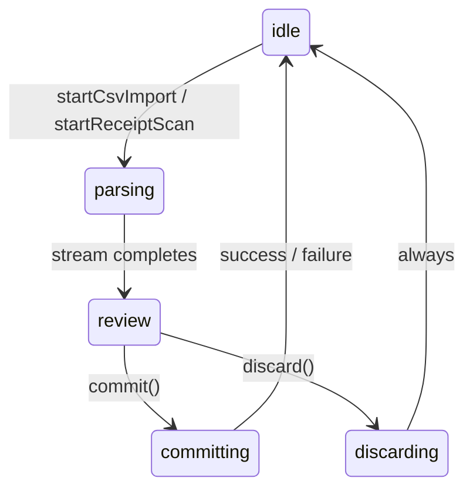

# ImportSessionController Reference

Brief summary: Comprehensive reference for ImportSessionController — the single coordinator for every CSV / receipt ingest session in Home Accounting POC. This guide explains the why, what, and how of ImportSessionController so future contributors can extend or consume it safely. Covers public API, lifecycle state machine, data structures, error handling, extension guide, testing guidelines, and contributor checklist.

## When to use this doc

Use this document when implementing, extending, consuming, or testing ImportSessionController or any import-related feature. It covers the full API surface, lifecycle, data contracts, and best practices.

## Responsibilities

ImportSessionController is the single coordinator for every *ingest* flow:

1. **Receives a stream of `ImportEvent`s** from an *import service* (CSV, OCR, …).
2. **Persists temporary files immediately** through `DraftCommitService` → `ISourceFileStore`.
3. **Lets the user review / edit** the parsed drafts in memory.
4. **Runs matching** (`matchDrafts`) to associate draft IDs (`TransactionDraftId`) with existing transactions.
5. **Commits** — delegating to `DraftCommitService` for transaction creation/update and file linking.
6. **Discards** — rolling back any orphan files that were already persisted.

## Architecture Role

### High-level

* **Own the import session state** (progress, active drafts, errors).
* **Fan-in events** from heavy parsers (`ICsvImportService`,
  `IReceiptParseService`) that run off-isolate.
* **Fan-out commands** to use cases and domain stores:

  * `DraftCommitService` – create/update transactions with file attachments.
  * `ISourceFileStore` – persist attachments early in the import process.
* **Expose an observable model** to Widgets/View-Models through `ChangeNotifier`.

### Boundaries

ImportSessionController is **logic-only**: it never touches Service Locator, platform
channels, or Flutter widgets.
All IO happens in the injected services, keeping unit tests pure.

### Collaboration Points

| Phase                                   | Called on ImportSessionController                                       | Method(s) invoked on *other* components                                                                                                                                                 | Purpose                                                                                                            |
| --------------------------------------- | ----------------------------------------------------------------------- | ----------------------------------------------------------------------------------------------------------------------------------------------------------------------------------- | ------------------------------------------------------------------------------------------------------------------ |
| **Parsing** (while `isImporting==true`) | `_onDraft()` for each `ImportDraftEvent` that contains `tempAttachment` | `DraftCommitService.persistTempAttachment()` → `ISourceFileStore.persistTempFile()` **(once per attachment)**                                                                      | Copies the temp file to permanent storage, returns a `SourceFile` row, and stores its ID in the draft collection. |
| **Commit**                              | `commit()` or `commitSingleById()`                                      | *Per draft*:<br>• `DraftCommitService.commitDraft()`<br>• Service includes `persistedFileId` if file was attached during parsing | Finalises data in the DB and creates the many-to-one link between transaction and file(s). **Attachment best-effort:** transaction create/update is committed first; file attachments are linked afterward. If attachment fails, the transaction change remains.                         |
| **Discard**                             | `discard()` or `discardSingleById()`                                    | `DraftCommitService.discardDraft()` → `ISourceFileStore.deleteSourceFile()` *(once for every previously persisted attachment)*                                                                                            | Removes orphaned blobs + rows when the user abandons the import.                                                   |
| **Read-only helpers**                   | `currentDrafts`, `idMatches`, etc.                  | none                                                                                                                                                                                | UI reads snapshots only; ImportSessionController owns mutation.                                                                |
| **Concurrent imports**                  | Multiple `start*()` calls                                               | Queued sequentially; second import waits for first to complete                                                                                                                      | Allows users to start multiple imports without conflicts.                                                          |

> **Why persist attachments early?**
> Users may abandon the app (or the OS may kill it) between parsing and commit.
> By copying the bytes immediately we guarantee we never lose the file path—even if we later discard the DB row.

> **Why delegate to DraftCommitService?**
> Centralizes transaction creation/update logic in a single place, making it reusable
> across different workflows (manual entry, import, etc.) and easier to test.

## Key Concepts & Data Structures

| Concept                     | File                                | Purpose                                                     |
| --------------------------- | ----------------------------------- | ----------------------------------------------------------- |
| `ImportSession`             | `i_import_session_controller.dart`  | Immutable session metadata (startedAt, source, byte size).  |
| `ImportEvent` sub-classes   | `i_import_session_controller.dart`  | Parser → controller stream: draft, progress, error.              |
| `DraftCollection`           | `draft_collection.dart`             | Manages drafts, matches, and file associations with stable IDs. |
| **Match & attachment state** | *Managed inside `DraftCollection`* | Suggestions, user overrides, and draft→file associations are stored ID-keyed. |

> **New in 2025-Q3:** all cross-store communication uses `TransactionDraftId` instead of list positions.
> Inside `ImportSessionController` we *may* continue to track drafts in a list for quick UI paging, but any method that leaves the controller boundary (public API, ViewModel interactions, persistence helpers) must pass the stable ID only.

> **Implementation note:** Internally implemented via `DraftCollection`; the public surface remains strictly ID-based.

### ImportEvent Contract

Import services **stream** exactly three event types, all declared next to
`IImportSessionController` so implementations stay de-coupled:

| Event class           | *When emitted*                                                                   | Payload                                                                                              |
| --------------------- | -------------------------------------------------------------------------------- | ----------------------------------------------------------------------------------------------------- |
| `ImportDraftEvent`    | Parser has fully populated a `TransactionDraft`.                                 | • `draft` – the parsed draft<br>• `tempAttachment` – `dart:io File` living in the OS cache (nullable). |
| `ImportProgressEvent` | Parser has made measurable progress.                                             | • `progressFraction` – `double` in **\[0 – 1]**                                                       |
| `ImportErrorEvent`    | Parser ran into a recoverable problem but can continue (e.g., malformed CSV row) | • `message` – human-readable description                                                              |

The stream **completes** (closes) when the parser has finished its work.
ImportSessionController subscribes to the parser stream in its internal import runner.

## Public API

```dart
Future<void> startCsvImport(File csv);
Future<void> startReceiptScan(
  File image, {
  required int sourceAccountId,
  required int targetAccountId,
});

/// Starts a receipt scan using an already-persisted source file.
/// This method opens the file from storage and parses it without re-persisting.
Future<void> startReceiptScanFromSourceFile(
  SourceFileId fileId, {
  required int sourceAccountId,
  required int targetAccountId,
});

Future<void> matchDrafts();    // heuristic auto-match

// ID-based operations (stable across list mutations)
void replaceDraftById(TransactionDraftId id, TransactionDraft draft);
void removeDraftById(TransactionDraftId id);
void updateMatchById({required TransactionDraftId id, TransactionId? existingTxId});
Future<Transaction> commitSingleById(TransactionDraftId id);
Future<void> discardSingleById(TransactionDraftId id);

// ID-based lookup helpers
TransactionDraft? draftById(TransactionDraftId id);
Map<TransactionDraftId, TransactionId?> get idMatches;
SourceFileId? pendingFileIdForDraft(TransactionDraftId id);

Future<List<Transaction>> commit();   // returns transactions in the order of currentDrafts at call time
Future<void> discard();  // delete orphaned files & reset
Future<void> cancel();   // cancel ongoing import
```

> **`cancel()` vs `discard()`**
> `cancel()` stops the current import stream **without clearing state**; drafts and pending files remain.
> `discard()` cancels if needed **and** deletes orphaned files, then resets the session. If it interrupts an active import, the pending `start*()` future completes with `ImportCancelledException`.

All getters (`current`, `currentDrafts`, `idMatches`, `progress`,
`isImporting`, `lastError`) are **read-only snapshots** and must be treated as
ephemeral—always listen for changes.

> **Why ID-based operations?**
> List positions become invalid whenever a user deletes, sorts or filters the list. Forwarding an index across layers causes *heisenbugs* once pagination or concurrent edits land (see Arch doc §4.1). **All draft manipulation uses `*ById()` methods** - they use stable `TransactionDraftId` identifiers that remain valid across list mutations.

### Listener Pattern

All public getters return a **snapshot** of internal state at *this very tick*.
They will get *out of date* the next time ImportSessionController:

* receives another `ImportEvent`,
* the user edits a draft,
* a commit/discard finishes,
* or an error occurs.

Therefore, **UI code must register listeners** instead of polling:

```dart
final import = context.watch<IImportSessionController>();   // Provider / Riverpod
return LinearProgressIndicator(value: import.progress);
```

or

```dart
ChangeNotifierProvider(
  create: (_) => importSessionController,
  child: Consumer<IImportSessionController>(
    builder: (_, controller, __) => Text(
      controller.lastError ?? 'All good',
    ),
  ),
);
```

Never cache a getter result for later mutation; ImportSessionController is the sole writer.

### idMatches Behavior

The `idMatches` getter returns a map of draft IDs to their matched transaction IDs. **Important**: the map **excludes** drafts with a `null` match; only matched entries are present. This provides a clean view of actual matches without cluttering the map with unmatched drafts.

## Lifecycle & State Machine



**Legend:** **idle** = no active session; **review** = session active, importing finished.

* **Parsing phase** – `_importing == true`, progress 0-1.

  * Each `ImportDraftEvent` may include a *temporary* file.
  * ImportSessionController calls `DraftCommitService.persistTempAttachment()`
    immediately (single copy) and records the resulting `SourceFile.id`.
* **Review phase** – user can edit drafts or matches.
* **Matching phase** – `matchDrafts()` updates the controller's match suggestions via the repository heuristic; the user can override any entry.
* **Commit** – iterates drafts; for each:

  * delegates to `DraftCommitService.commitDraft()` with draft record
  * service handles the "create vs update" decision logic
  * service includes `persistedFileId` if file was attached during parsing
* **Discard** – removes any files that were persisted during parsing but no
  longer needed.

> **Concurrent imports**
> Multiple `start*()` calls are queued and processed sequentially. The second import waits for the first to complete, then continues in the same session. This prevents conflicts while allowing users to start multiple imports.

### Persistence Flow

```mermaid
stateDiagram-v2
    %% top-level
    [*] --> Idle

    state Idle {
        Idle_Init : ready
    }

    Idle --> Parsing : startCsvImport / startReceiptScan
    state Parsing {
        note right of Parsing : _importing = true
        Parsing : progress 0–1\n(drafts grow)\nfiles persisted
        Parsing --> Parsing : ImportDraftEvent\n• add draft\n• persist attachment
        Parsing --> Parsing : ImportProgressEvent
        Parsing --> Parsing : ImportErrorEvent
    }
    Parsing --> Review : stream closed\n_importing = false

    state Review {
        Review : user may:\nreplaceDraft\nupdateMatch\nremoveDraft\nmatchDrafts
    }

    Review --> Matching : matchDrafts()
    state Matching {
        Matching : heuristic fills\n_matchSuggestions
    }
    Matching --> Review : done

    Review --> Committing : commit()
    state Committing {
        Committing : for each draft\n• DraftCommitService.commitDraft\n• (id loop)
    }
    Committing --> Idle : success\n(clear state)

    Review --> Discarding : discard()
    state Discarding {
        Discarding : delete orphan\nSourceFile rows & blobs
    }
    Discarding --> Idle : done
```

*The diagram now shows exactly where persistence and matching steps occur, with the delegation to DraftCommitService.*

### Concurrent Imports

ImportSessionController supports **concurrent imports** and **continuation sessions**:

* **Concurrent imports**: Multiple `startCsvImport()` or `startReceiptScan()` calls are queued and processed sequentially. The second import waits for the first to complete, then continues in the same session.

* **Continuation sessions**: If a session is already active, new imports add to the existing session rather than starting fresh. The session's `totalBytes` is updated to reflect the cumulative size.

* **Auto-finish**: When all drafts are removed and no import is in progress, the session automatically resets to idle state.

* **Cancellation**: `discard()` cancels any ongoing import stream and cleans up resources, but allows the queue to reset for future imports.

* **Import cancellation**: If `discard()` interrupts an active import, the pending `start*()` future completes with an **ImportCancelledException** so callers can handle the cancellation explicitly.

## Error Handling

| Layer                               | Example                | Propagation                                                         |
| ----------------------------------- | ---------------------- | ------------------------------------------------------------------- |
| Parser emits `ImportErrorEvent`     | Malformed CSV row      | Stored in `lastError`, UI may show toast; parsing continues.        |
| Persistence error inside `_onDraft` | Disk full on file copy | Logged & stored in `lastError`; draft is still kept.                |
| Commit / discard failures           | DB dead-lock           | Thrown to caller; ImportSessionController resets **only when** helpers succeed. |

`runLogged()` centralises `try/catch` + logging; it re-throws so tests can
assert failures.

## Extension Guide

### Add a new ingestion channel

1. Create an `IXyzImportService` that converts bytes → `Stream<ImportEvent>`.
2. Inject it in the constructor.
3. Add a `startXyzImport(File xyz)` that forwards to the internal import runner.

### Support additional attachment metadata

Change only the `persistTempAttachment()` call site:

```dart
final _meta = jsonEncode({'mime': 'image/png', 'sha1': sha1});
final sf   = await _draftCommitService.persistTempAttachment(event.tempAttachment!, metadata: _meta);
```

Nothing else needs modifications.

### Long-running commit

If you introduce bulk network calls, wrap each in `runLogged()` and consider
`await Future.wait()` to parallelise.

### Add ID-based operations

If you add new draft manipulation methods, prefer ID-based signatures over index-based ones:

```dart
// ✅ Preferred - stable across list mutations
Future<void> myOperationById(TransactionDraftId id);

// ❌ Avoid - breaks when list changes
void myOperationAt(int index);
```

### Handle concurrent imports

The import queue automatically handles concurrent `start*()` calls. If you add new import sources, they'll automatically benefit from this queuing behavior.

## Testing Guidelines

* **Unit** – see `import_session_controller_unit_test.dart`. Use `Stream.fromIterable`
  to feed deterministic events; verify listener calls with *mocktail*.
* **Concurrency** – `import_session_controller_concurrency_test.dart` holds the pattern:
  a `StreamController` keeps the parser busy while you fire a second start.
* **ID-based operations** – Test `draftById()`, `idMatches`, and the new `commitSingleById()`/`discardSingleById()` methods to ensure they work correctly across list mutations.
* **Integration** – emulate real file persistence by injecting
  `FakeFileStorageService` & `FakeSourceFileStore`.
* **Use case integration** – verify that `DraftCommitService` is called with correct parameters.

## Common Pitfalls

| Pitfall                                        | How to avoid                                                                  |
| ---------------------------------------------- | ----------------------------------------------------------------------------- |
| Double-copy of temp files                      | Always use `DraftCommitService.persistTempAttachment()` **once** – never copy in UI code.              |
| UI comparing `File` identities                 | Compare `path` or use `FileSystemEntity.identical` – ImportSessionController wraps files. |
| Not listening to `notifyListeners()`           | Wrap view-models in `ChangeNotifierProvider` (Riverpod / Provider).           |
| Passing list indices to another layer (e.g. ViewModel → Controller) | **Always pass** the `TransactionDraftId` instead. Indices become stale after list mutations. |
| Holding stale list indices in UI code         | Store the `TransactionDraftId` in UI state, not the list position. Use `draftById()` for lookups. |
| Assuming concurrent imports will be rejected | ImportSessionController queues concurrent imports; they run sequentially in the same session. |
| Directly calling transaction stores | Always delegate to `DraftCommitService` for transaction operations to maintain consistency. |

## FAQ

* **Q: Why not keep the temporary `dart:io File` path and copy on commit?**
  A: Users may quit the app mid-import; persisting early guarantees drafts are
  resumable and leaves only a DB row to roll back.

* **Q: Can I plug in a different storage backend (e.g., cloud)?**
  Yes. Implement a new `IFileStorageService` that uses your backend; the controller
  doesn't care as long as `FileHandle.absolutePath()` resolves locally for
  `openFile()`.

* **Q: How do I get progress for commit()?**
  ImportSessionController deliberately keeps commit synchronous; show a modal spinner in
  UI. If you need granular progress wrap internal loops in a `StreamController`
  and expose another getter.

* **Q: Why can't I just pass the list index? It's faster to find things.**
  A: Because the index is *not stable* once the user deletes or re-orders drafts. Use `TransactionDraftId` instead - it remains valid across all list mutations. ImportSessionController provides O(1) lookup methods (`draftById(id)`) so performance is maintained without the stability issues.

* **Q: What happens if I start multiple imports at once?**
  A: ImportSessionController queues concurrent imports and processes them sequentially. The second import waits for the first to complete, then continues in the same session. This prevents conflicts while allowing users to start multiple imports.

* **Q: How do I commit or discard individual drafts?**
  A: Use `commitSingleById(draftId)` or `discardSingleById(draftId)` instead of the bulk `commit()`/`discard()` methods. These methods work with stable IDs and automatically clean up the draft from the session.

* **Q: Why delegate to DraftCommitService instead of calling stores directly?**
  A: Centralizes transaction creation/update logic in a single place, making it reusable across different workflows (manual entry, import, etc.) and easier to test. The service handles the "create vs update" decision logic.

## Reference Snippets

### Start a CSV import from a Widget

```dart
final file = await FilePicker.platform.pickFiles(
  type: FileType.custom,
  allowedExtensions: ['csv'],
);
if (file != null) {
  context.read<IImportSessionController>().startCsvImport(File(file.single.path!));
}
```

### Start a receipt scan with account IDs

```dart
final file = await FilePicker.platform.pickFiles(
  type: FileType.custom,
  allowedExtensions: ['jpg', 'png', 'pdf'],
);
if (file != null) {
  context.read<IImportSessionController>().startReceiptScan(
    File(file.single.path!),
    sourceAccountId: 1,
    targetAccountId: 2,
  );
}
```

### Start a receipt scan from persisted file (persist-first flow)

```dart
// After file is already persisted to storage
await context.read<IImportSessionController>().startReceiptScanFromSourceFile(
  sourceFileId,
  sourceAccountId: 1,
  targetAccountId: 2,
);
```

### Listen for completion

```dart
final importing = context.select<IImportSessionController, bool>((s) => s.isImporting);
if (importing) {
  final progress = context.select<IImportSessionController, double>((s) => s.progress);
  return LinearProgressIndicator(value: progress);
}
return const SizedBox.shrink();
```

### Commit in a View-Model

```dart
final import = rootStore.importSessionController;
await import.matchDrafts();   // optional – gives suggestions
await import.commit();        // throws on fatal
_scaffold.showSnackBar(const SnackBar(content: Text('Import done')));
```

### Updated cheat-sheet

```dart
/// Start an import (CSV example)
await context.read<IImportSessionController>().startCsvImport(csvFile);

/// Start receipt scan with account IDs
await context.read<IImportSessionController>().startReceiptScan(
  imageFile,
  sourceAccountId: 1,
  targetAccountId: 2,
);

/// Start receipt scan from persisted file
await context.read<IImportSessionController>().startReceiptScanFromSourceFile(
  sourceFileId,
  sourceAccountId: 1,
  targetAccountId: 2,
);

/// Auto-match drafts to existing transactions
await context.read<IImportSessionController>().matchDrafts();

/// Show progress
Selector<IImportSessionController,double>(
  selector: (_, s) => s.progress,
  builder : (_, p, __) => LinearProgressIndicator(value: p),
);

/// Commit after user review
try {
  await context.read<IImportSessionController>().commit();
  ScaffoldMessenger.of(context).showSnackBar(
    const SnackBar(content: Text('Import complete!')),
  );
} catch (e) {
  // handle / show error
}

/// ID-based operations (PREFERRED - stable across list mutations)
final draft = controller.draftById(draftId);
if (draft != null) {
  // Replace draft with updated content
  final updatedDraft = draft.copyWith(amountCents: 1500);
  controller.replaceDraftById(draftId, updatedDraft);

  // Update match for specific draft
  controller.updateMatchById(id: draftId, existingTxId: transactionId);

  // Commit single draft
  final tx = await controller.commitSingleById(draftId);

  // Or discard single draft
  await controller.discardSingleById(draftId);

  // Or remove draft from session
  controller.removeDraftById(draftId);
}

/// Get stable matches by ID (not affected by list mutations)
final idMatches = controller.idMatches;
final match = idMatches[draftId];

/// Check if draft has pending file attachment
final fileId = controller.pendingFileIdForDraft(draftId);
if (fileId != null) {
  // Draft has an attached file
}
```

## Contributor Checklist

* [ ] Any new parser emits the **three** standard events only.
* [ ] No UI code assigns to public fields of ImportSessionController; all mutations must go through the provided commands (`replaceDraftById`, `removeDraftById`, `updateMatchById`, …).
* [ ] All new async blocks wrapped in `runLogged()`.
* [ ] Unit tests cover happy-path + failure + concurrency.
* [ ] README / change-log updated.
* [ ] No public API or cross-layer call relies on list indices; **only stable IDs**.
* [ ] **All draft manipulation uses ID-based methods** (`replaceDraftById`, `removeDraftById`).
* [ ] **No index-based draft manipulation methods exist** in the public API.
* [ ] Concurrent import behavior is tested and documented.
* [ ] Transaction operations delegate to `DraftCommitService` instead of calling stores directly.
* [ ] `DraftCommitService` methods are called with correct parameters.

## Related docs

- [Architecture Overview](/docs/app/explanation/architecture-overview.md)
- [Data Persistence](/docs/app/reference/architecture/data-persistence.md)
- [Contribution Guidance](/docs/app/reference/contribution-guidelines.md)
- [Controllers Reference Index](/docs/app/reference/controllers/index.md)
